# Arquitetura do Módulo de Pagamentos (Integração OpenPix)

Este documento descreve o funcionamento do módulo de processamento de pagamentos via PIX da plataforma, detalhando o fluxo de recepção de webhooks, os padrões arquiteturais aplicados e as garantias de resiliência.

## 1. Visão Geral do Fluxo (Webhook)

O diagrama abaixo ilustra o caminho que um evento de pagamento (Webhook da OpenPix) percorre desde o momento que atinge nossa API até a efetivação das regras de negócio (notificação, baixa de estoque, etc).

```mermaid
sequenceDiagram
    participant PSP as OpenPix
    participant API as Webhook Route
    participant DB as PostgreSQL
    participant BullMQ as Worker (Redis)
    participant App as Serviços de Domínio

    PSP->>API: POST /api/webhooks/openpix (Payload PIX)
    
    rect rgb(23, 32, 42)
    Note right of API: 1. Anti-Corruption Layer
    API->>API: Valida Assinatura (Segurança)
    API->>API: Valida Payload com Zod
    end

    rect rgb(23, 32, 42)
    Note right of API: 2. Transação Atômica (Tudo ou Nada)
    API->>DB: BEGIN TRANSACTION
    DB->>DB: INSERT webhookInbox (Idempotência)
    alt Já processado (Unique Violation)
        DB-->>API: ROLLBACK (Erro 23505)
        API-->>PSP: 200 OK (Ignora e encerra)
    else Novo Evento
        DB->>DB: Busca Pagamento Atual
        DB->>DB: UPDATE Pagamento = PAID (se ainda estiver PENDING)
        DB->>DB: INSERT Log em paymentEvents
        DB->>DB: INSERT Evento em eventsOutbox (Status: PENDING)
        DB-->>API: COMMIT TRANSACTION
    end
    end

    API-->>PSP: 200 OK (Processado com Sucesso)

    rect rgb(23, 32, 42)
    Note right of BullMQ: 3. Processamento Assíncrono
    BullMQ->>DB: Poll de eventsOutbox (Status: PENDING)
    BullMQ->>App: Executa Regras de Negócio (Estoque, Lojista)
    App-->>BullMQ: Sucesso
    BullMQ->>DB: Update eventsOutbox (Status: PROCESSED)
    end
```

## 2. Padrões Arquiteturais Utilizados

O módulo foi desenhado combinando padrões modernos de sistemas distribuídos para evitar dores de cabeça com concorrência e falhas de rede.

### 2.1. Anti-Corruption Layer (ACL)
Nenhum dado externo entra na nossa aplicação sem passar pelo crivo do Zod. Isso blinda o núcleo do sistema contra mudanças de API do provedor ou payloads malformados.
- **Implementação:** Validação estrita do body usando Zod antes de qualquer interação com o banco.

### 2.2. Inbox Pattern Transacional (Idempotência)
Serviços de pagamento garantem "at-least-once delivery" (entregam o webhook pelo menos uma vez).
- **Implementação:** Gravamos cada ID de evento recebido na tabela `webhookInbox` **dentro da mesma transação** do update do pagamento. Se o webhook bater duas vezes, o segundo gerará um erro `23505` (Unique Violation), sofrendo *Rollback* automático. Em seguida, o bloco `catch` intercepta o erro e devolve `200 OK` ao provedor para parar o retry. Agrupar o Inbox na mesma transação previne falsos positivos caso o banco caia no meio do processo.

### 2.3. Controle de Concorrência Otimista (Optimistic Concurrency Control)
Para evitar "Race Conditions" (duas requisições de pagamento diferentes confirmando o mesmo pedido ao mesmo tempo), não usamos bloqueios severos no banco (como nível *Serializable*).
- **Implementação:** Usamos uma cláusula condicional no UPDATE (`WHERE id = X AND status = 'PENDING'`). Se duas requisições passarem pelo Inbox juntas, a primeira atualizará para `PAID`, e a segunda tentará atualizar onde o status for `PENDING` (não achará nada, afetando 0 linhas), evadindo a "Dupla Execução" e impedindo que o evento vá para o Outbox duas vezes.

### 2.4. Transactional Outbox Pattern
Evita o clássico problema de *Dual Write* (atualizar o banco mas falhar ao enviar o e-mail).
- **Implementação:** Durante o webhook, não executamos regras de negócio pesadas. Apenas inserimos um registro na tabela `eventsOutbox` na mesma transação do banco de dados que confirmou o pagamento. Um worker assíncrono assume o trabalho pesado depois.

### 2.5. Micro-Retries em Integrações de Rede
Falhas de rede entre nosso sistema e APIs externas (OpenPix) são comuns e temporárias.
- **Implementação:** Em vez de retornar um erro 500 imediato para o usuário na hora do Checkout, a geração do PIX é envolvida num laço (*while loop*) com limite de tentativas e um *progressive backoff* (espera de 1s, 2s). Isso absorve a maioria dos "piscares de luz" da infraestrutura de terceiros, oferecendo uma experiência transparente ao usuário final.

### 2.6. Event Sourcing / Audit Logging
Pagamentos são dados críticos.
- **Implementação:** A tabela `paymentEvents` atua como um histórico imutável (append-only) de todas as transições de estado pelo qual aquele pagamento passou, útil para auditoria.

## 3. Avaliação de Complexidade (Overkill?)

Esta arquitetura pode parecer complexa à primeira vista ("overkill") para um MVP, mas em sistemas que lidam com dinheiro, ela previne problemas que seriam catastróficos para a retenção de usuários.

**Por que a complexidade se justifica:**
1. **Ambiente Serverless:** Rotas de API no Next.js (App Router) possuem limites de tempo de execução. Realizar fluxos pesados e síncronos na mesma requisição do webhook causaria cancelamento e retentativas infinitas da OpenPix.
2. **Dinheiro Envolvido:** Confeiteiros lidam com alto volume próximo a feriados. Falhar em reconhecer um PIX pago (ou dobrar a notificação) gera desconfiança fatal. A garantia transacional (tudo ou nada) dá paz de espírito.
3. **Escalabilidade Natural:** A arquitetura atende aos requisitos do `GEMINI.md` sobre isolamento funcional. A base assíncrona (Outbox/BullMQ) está pronta para processar envios de SMS/WhatsApp massivos no futuro.

---

## 4. Roteiro para Entrevistas (Como vender sua Arquitetura)

Se questionado em uma entrevista técnica de nível Pleno/Sênior sobre como você modelou este sistema de pagamentos, use este roteiro para demonstrar maturidade nas decisões:

**1. O Desafio Central (Contexto)**
> *"Ao desenhar a arquitetura de checkout, o foco foi **resiliência**. Pagamento é o coração do sistema: o status não pode ser perdido, não podemos dar dupla baixa de estoque num falso-positivo e precisamos responder à OpenPix em milissegundos para não gerar Timeouts. Para piorar, nosso front-end interage com APIs de terceiros que podem oscilar."*

**2. A Solução (Desacoplamento)**
> *"Para resolver isso, decidi desacoplar o fluxo. A rota do Webhook só tem a responsabilidade de confirmar o pagamento no banco da forma mais segura possível, usando os padrões Inbox e Outbox transacionais."*

**3. Transação Atômica (Mostrando Domínio de Banco de Dados)**
> *"O grande segredo do webhook é que ele inteiro roda numa única **Transação ACID** do PostgreSQL. Dentro da transação eu tento inserir o evento no Inbox, atualizo a tabela de pagamento e jogo o evento no Outbox. Se o Webhook for uma duplicata (a rede enviou duas vezes), a constraint UNIQUE do Inbox do Postgres interrompe a transação com um erro `23505`. Meu código intercepta esse rollback e devolve `200 OK` amigável pra API parar de mandar. Zero risco de erro parcial."*

**4. O Pulo do Gato (Optimistic Concurrency Control)**
> *"Mesmo com tudo na transação, e operando no isolamento padrão Read Committed do Postgres, eu precisei blindar contra as 'Race Conditions' (duas requisições simultâneas para o mesmo pedido mas com IDs de evento diferentes). Eu fiz isso mudando o update pra uma **Atualização Condicional Otimista**: o código só atualiza pra PAID se, no exato milissegundo em que rodar, a coluna status ainda estiver como PENDING. Se não afetar nenhuma linha, significa que perdeu a 'corrida', eu cancelo o evento e não gero duplo disparo pro lojista."*

**5. Micro-Retries (Foco em UX)**
> *"No outro extremo do sistema, que é o usuário final clicando no botão 'Pagar', implementei resiliência de rede. Ao invés de jogar um Erro 500 na cara do cliente se a OpenPix der timeout, a chamada de geração do PIX é embalada num laço de Micro-Retries com progressive backoff (1s, 2s). O usuário espera um pouco mais no Loading do botão, mas a conversão ocorre normalmente, absorvendo as oscilações da nuvem."*

**6. Finalizando com Processamento Assíncrono**
> *"No fim, um Worker isolado lê aquele Outbox e processa os envios de e-mails pesados de forma assíncrona usando BullMQ. Se o provedor de e-mail cair, só a fila falha e retenta depois. O banco de dados e o cliente final já estão tranquilos com a vida garantida."*
